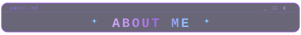
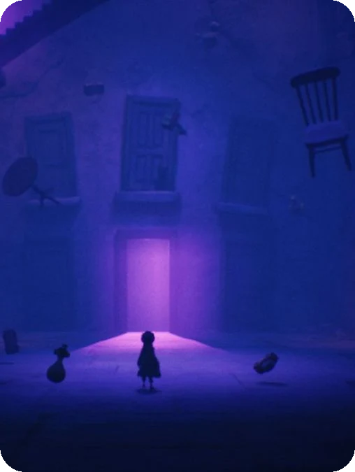
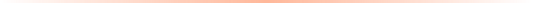
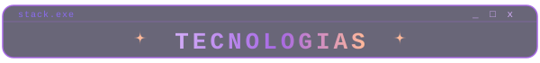
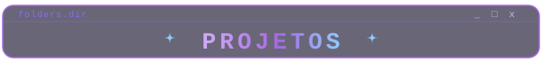
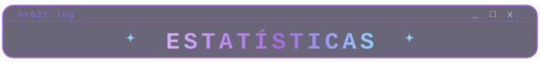
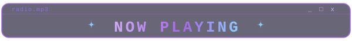
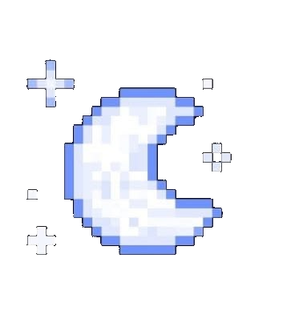

  

  

  
  
  
  

  

 

<h2 align="center">
  
</h2>

 

  Oi! 🌙 <em><b>Eu sou a Mizzie</b></em>, estudante de <b>Análise e Desenvolvimento de Sistemas</b> na Fatec Itapetininga. Este cantinho da internet é onde eu guardo meus <b>projetos</b> e meus <b>estudos de programação</b>, principalmente em <b>C++</b>, e onde compartilho o que vou aprendendo pelo caminho. ✨ Sou curiosa por natureza, apaixonada pelo cosmos, e estou sempre com vontade de aprender, construir coisas e crescer como desenvolvedora.

  

   
   <code>Estudando na FATEC</code>
  &nbsp;&nbsp;
   <code>Aprendendo todo dia</code>
  &nbsp;&nbsp;
   <code>Aberta a conversas</code>
    

  

 

 ${\color{#a668e3} In \space all \space chaos \space there \space is \space a \space cosmos, \space in \space all \space cosmos \space there \space is \space a \space coordinated \space orbit.}$ ಣ𓈒ֵ۫    
 ${\color{#d1abf7} the \space closer \space you \space look \space \space ྀི \space ˚̣ \space the \space less \space you \space see}$ 

 
 

<h2 align="center">
  
</h2>

  
  
  

<!-- Quando aprender algo novo, copie uma linha acima e troque o nome e o logo.
     Exemplo: https://img.shields.io/badge/PYTHON-a668e3?style=for-the-badge&logo=python&logoColor=f5f0ff
     Lista de logos: https://simpleicons.org -->

 

<h2 align="center">
  
</h2>

| 🌙 repositório | sobre | linguagem |
|:--|:--|:--|
| [**ADS-Fatec**](https://github.com/MizzieWiller/ADS-Fatec) | Resumos de aulas, atividades e projetos do curso de ADS na Fatec Itapetininga | `C++` |

[`1°Ciclo`](https://github.com/MizzieWiller/ADS-Fatec/tree/main/1%C2%B0Ciclo) · [`3° Ciclo`](https://github.com/MizzieWiller/ADS-Fatec/tree/main/3%C2%B0%20Ciclo)

 

<h2 align="center">
  
</h2>

  
  

  

 

<h2 align="center">
  
</h2>

  

[୨](https://cinemitic.carrd.co) [-.. .- -. -.-. .. -. --. / .. -. / - .... . / -.-. --- ... -- --- ...](https://open.spotify.com/playlist/7aSO3XeyktGlcrr5O60NlI?si=37ddf21c04204416) [୧](https://pin.it/lNf0QdrCs)

 

  

  

